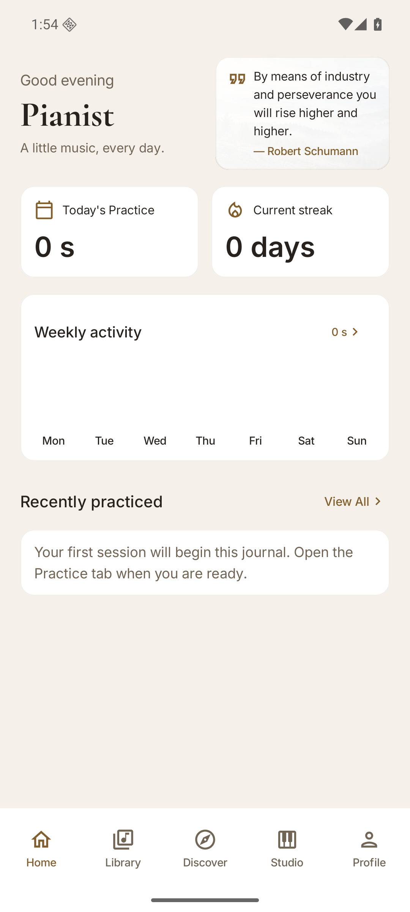
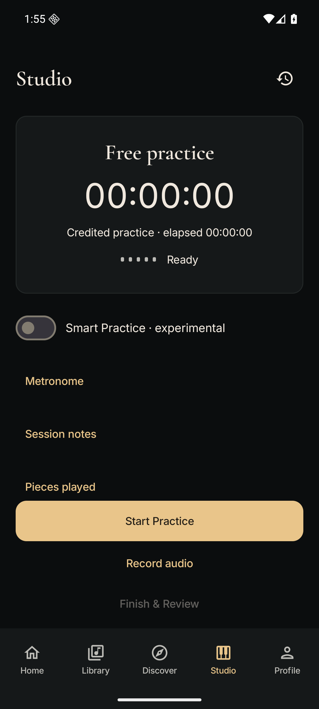
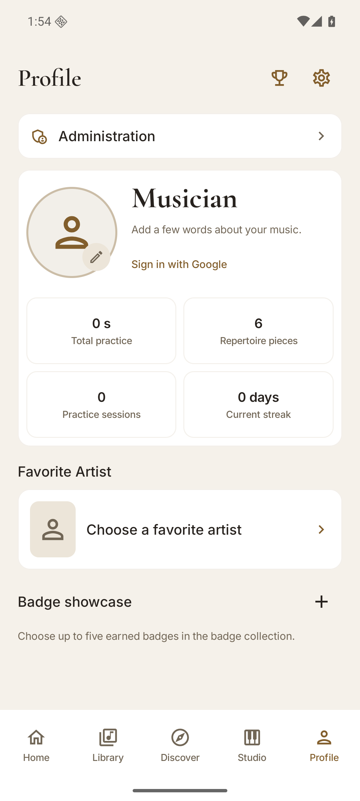

<h1>Gould</h1>

<strong>Make every practice session count.</strong>

A thoughtful, local-first piano practice companion for Android. 
Build your repertoire, record your sessions, and see how far you've come.

<a href="https://github.com/stokonn/Gould/releases/tag/v0.13"><strong>Gould 0.13 — latest pre-release</strong></a> · <a href="https://github.com/stokonn/Gould/releases/tag/v0.12">Gould 0.12</a> · <a href="docs/wiki/User-Guide.md">User guide</a>

---

## Your music. Your progress.

Gould brings the practical parts of piano practice together without turning your journal into another social network.

| 🎼 **Repertoire & history** | ⏱️ **Practice Studio** | 🎙️ **Local recordings** |
| :--- | :--- | :--- |
| Organize your pieces, browse the local catalogue and revisit past sessions. | Track manual sessions, use experimental Smart Practice, add notes, switch pieces and use the metronome. | Record deliberately from **Record → Stop**, then replay, export or recover saved takes. |

| 📊 **Progress & achievements** | 📱 **Home-screen widgets** | 💾 **Backups & control** |
| :--- | :--- | :--- |
| Follow weekly activity, statistics and earned badges. | Quick Practice and Weekly Activity bring your journal to the launcher without automatically starting the microphone or timer. | Export and restore portable journal backups, with a separate option for audio files. |

## A look inside

<table>
  <tr>
    <th align="center">Home</th>
    <th align="center">Practice Studio</th>
    <th align="center">Profile</th>
  </tr>
  <tr>
    <td align="center"></td>
    <td align="center"></td>
    <td align="center"></td>
  </tr>
</table>

Screenshots captured from the Gould 0.13 pre-release on an Android API 36 emulator, using fictional demo data. See the [capture evidence](docs/wiki/images/gould-0.13/CAPTURE-EVIDENCE.md) and [English screenshot plan](docs/planning/gould-0.13/README-SCREENSHOT-CAPTURE.md).

## Get Gould

**Latest published pre-release: [Gould 0.13 — Project Renaissance](https://github.com/stokonn/Gould/releases/tag/v0.13)**. [Gould 0.12 — The Practice Studio Update](https://github.com/stokonn/Gould/releases/tag/v0.12) remains available as an earlier release.

- **Android:** 8.0 or newer (API 26+).
- **Languages:** English and Czech, with light and dark appearance.
- **Install:** download the signed [Gould-v0.13.apk](https://github.com/stokonn/Gould/releases/download/v0.13/Gould-v0.13.apk) from GitHub Releases; this is a **pre-release**, not Stable.
- **Already using Goldberg/Gould?** Export a backup before updating, then install over your existing compatible application. **Do not uninstall** just to bypass a signing or version mismatch.
- **Release integrity:** the [published SHA-256 checksum](https://github.com/stokonn/Gould/releases/download/v0.13/Gould-v0.13.apk.sha256) is available alongside the APK.

[All releases](https://github.com/stokonn/Gould/releases) · [Getting started](docs/wiki/Getting-Started.md) · [FAQ & troubleshooting](docs/wiki/FAQ-and-Troubleshooting.md)

## Privacy by design

Your practice journal, repertoire, saved recordings, profile and backups are local to your device unless you deliberately export them. Optional online catalogue-provider searches require separate consent; Google profile sign-in does **not** synchronize your practice data. Microphone recording starts only when you explicitly request it.

The restricted first-party catalogue service exposes read-only catalogue endpoints and currently has no approved published catalogue records. Community submissions, backend OAuth and practice-data uploads remain disabled; this does not affect local practice. [Backend architecture and deployment boundaries](docs/architecture/BACKEND-DECISION-2026-10-31.md). Smart Practice sound detection is experimental, not a perfect measure of piano activity.

[Privacy information](docs/PRIVACY.md) · [Settings & data controls](docs/wiki/Settings-and-Customization.md)

## Built for pianists, built with Kotlin

Gould is a native Android app using **Kotlin**, **Jetpack Compose**, **Material 3** and **Room**. Its roots are in **Opus → Goldberg → Gould**; earlier names remain in some technical paths to preserve app and database compatibility.

For developers:

- Start with [AGENTS.md](AGENTS.md) for repository and release-safety rules, and the [Developer Guide](docs/wiki/Developer-Guide.md) for architecture.
- Use **JDK 17**, **Android SDK 36** and the committed Gradle wrapper.
- Gould **0.13 Project Renaissance** is published as a [pre-release](https://github.com/stokonn/Gould/releases/tag/v0.13), not Stable. See its [release notes](docs/releases/GOULD-0.13.md), [release readiness](docs/planning/gould-0.13/RELEASE-READINESS.md), and the [English screenshot capture plan](docs/planning/gould-0.13/README-SCREENSHOT-CAPTURE.md).
- Source compilation and CI are not substitutes for on-device, upgrade or release-signing acceptance. Published releases undergo separate checks.

[Changelog](CHANGELOG.md) · [Third-party licences and credits](docs/LICENSES.md) · [Signing guidance](docs/SIGNING.md) · [Wiki](https://github.com/stokonn/Gould/wiki)

## Enjoy using Gould?

If Gould helps your practice or you find the code useful, consider **[starring the repository ⭐](https://github.com/stokonn/Gould/stargazers)**. It makes the project easier for other musicians and Android developers to discover. Feedback and reproducible bug reports are welcome in [Issues](https://github.com/stokonn/Gould/issues).

---

created by stokonn with love &lt;3

