# Gould — Piano Practice Journal

> **Latest release:** [Gould 0.15.0 (pre-release)](https://github.com/stokonn/Gould/releases/tag/v0.15.0). It is not Stable.

Gould is a local-first Android music practice journal for repertoire, sessions, notes, recordings and achievements. Library includes a curated, sourced music catalogue. Studio supports manual or experimental Smart Practice and explicit local audio recording. Discover remains preserved but is temporarily hidden from the current navigation.

**Download:** [Gould 0.15.0 Pre-release](https://github.com/stokonn/Gould/releases/tag/v0.15.0) · [All releases](https://github.com/stokonn/Gould/releases).

## Gould 0.15.0

The current pre-release adds a curated offline catalogue (100 composers, 105,032 works and 105,421 composer relationships), opt-in online MusicBrainz search, redesigned Library and Artist pages, guided onboarding and safer community-draft recovery. Activity week completion consistently requires both configured weekly goals.

The published APK is the exact artifact the owner tested on a Samsung Galaxy A55. Android instrumentation was compiled but **not executed**; this is not an instrumentation pass. See the [0.15 release notes](https://github.com/stokonn/Gould/blob/main/docs/releases/GOULD-0.15.md) and [verification report](https://github.com/stokonn/Gould/blob/main/docs/planning/gould-0.15/RELEASE-VERIFICATION.md).

## Next development cycle

Gould 0.16 planning is focused on catalogue/database loading and search performance, plus UI responsiveness and loading states. The implementation scope is still under review. No performance improvement is claimed before repeatable measurements, and no database or language rewrite has been approved.

## Data and privacy

Practice data and recordings remain local unless deliberately exported. The composer catalogue is bundled locally; optional online catalogue search talks to third-party providers such as MusicBrainz directly from your device and requires explicit consent. Gould operates no product community backend, BFF or cloud catalogue API. Google sign-in uses Android Credential Manager and stays on the device; there are no community submissions or practice uploads.

See the [Gould 0.13 guide screenshots](images/gould-0.13/CAPTURE-EVIDENCE.md) for historical verified emulator captures. They are not physical-device evidence.

[Getting Started](Getting-Started) · [User Guide](User-Guide) · [Settings & Customization](Settings-and-Customization) · [Developer Guide](Developer-Guide) · [FAQ & Troubleshooting](FAQ-and-Troubleshooting) · [Changelog & Roadmap](Changelog-and-Roadmap) · [Credits & Licenses](Credits-and-Licenses)

created by stokonn with love <3

Preserved earlier documentation and dated development history

## Goldberg 0.11-rc.1 — published release candidate (October 25, 2026)

[Download Goldberg 0.11-rc.1](https://github.com/stokonn/Gould/releases/tag/v0.11-rc.1).
The candidate is a signed, non-debuggable release build, versionCode 12. Goldberg
0.10.1 remains the latest stable release. Catalogue, encyclopedia, offline bundles,
Smart Cache and accepted Android UI work are included; the Stage 8 Settings focus,
full navigation labels and test-scaffold contrast corrections are included.

**At that time, production community networking, cloud sign-in and real-user
contribution collection remained disabled, and no private Cloudflare Worker had
been deployed. A private Supabase schema existed but was never a live public
community service. The community/backend architecture has since been retired
entirely (see [backend retirement](https://github.com/stokonn/Gould/blob/main/docs/architecture/BACKEND-RETIRED-2026-11-25.md));
personal practice data remains local.**

[Candidate CI](https://github.com/stokonn/Gould/actions/runs/40212684482):302 JVM
cases passed;203 native cases,192 passed/11 existing fixture or probe-dependent
skips/0 failures on API36. Seeded 0.10.1 upgrade preserved original rows, preferences
and37 sessions;offline startup and process-death integrity checks passed. CI uses
debug rebuilds;the release APK certificate was independently verified against the
published APK. Final0.11/cloud acceptance remains open for credentials/privateTLS/
OAuth,privacy/source policy,operational backup custody and public API/client adoption.

Earlier dated entries below are historical and are superseded by this candidate
status where they describe pending UI corrections or the absence of a candidate.

---

# Goldberg

Goldberg is a native Android music journal for classical pianists, created by stokonn. It combines a personal repertoire, manual and experimental Smart Practice timing, multi-piece session review, statistics and earned badges.

The current release is [Goldberg 0.10.1](https://github.com/stokonn/Gould/releases/tag/v0.10.1). It refines the editorial interface, local composer favorites, Favorite Artist selection and historical session editing while preserving the existing practice journal. Google identity is optional profile identity, not cloud practice synchronization.

Start with [Getting Started](Getting-Started), then read the [User Guide](User-Guide). See [Settings & Customization](Settings-and-Customization), [FAQ & Troubleshooting](FAQ-and-Troubleshooting), [Developer Guide](Developer-Guide), [Changelog & Roadmap](Changelog-and-Roadmap) and [Credits & Licenses](Credits-and-Licenses).

Screenshots are added only after actual emulator capture and inspection. No illustrative mockup is presented as a verified app screenshot. Codex performs no physical-phone testing; owner-reported results are attributed separately below.

created by stokonn with love <3

## Goldberg 0.10.1 emulator captures

These inspected captures use a generic local identity. No private reference images or new third-party portrait files are published here.

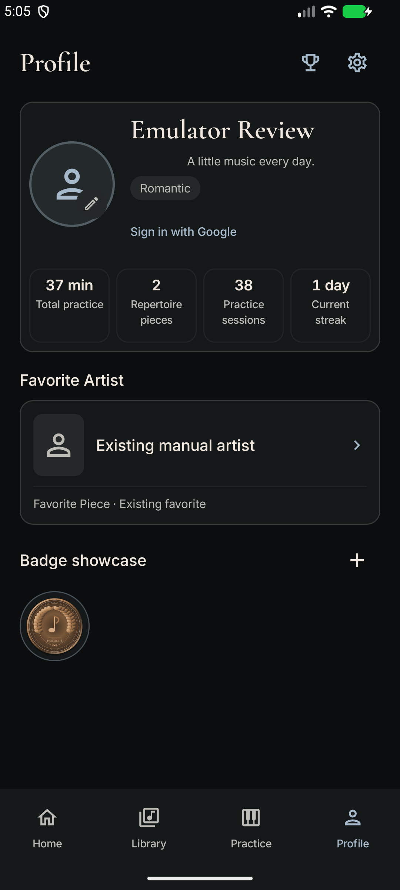

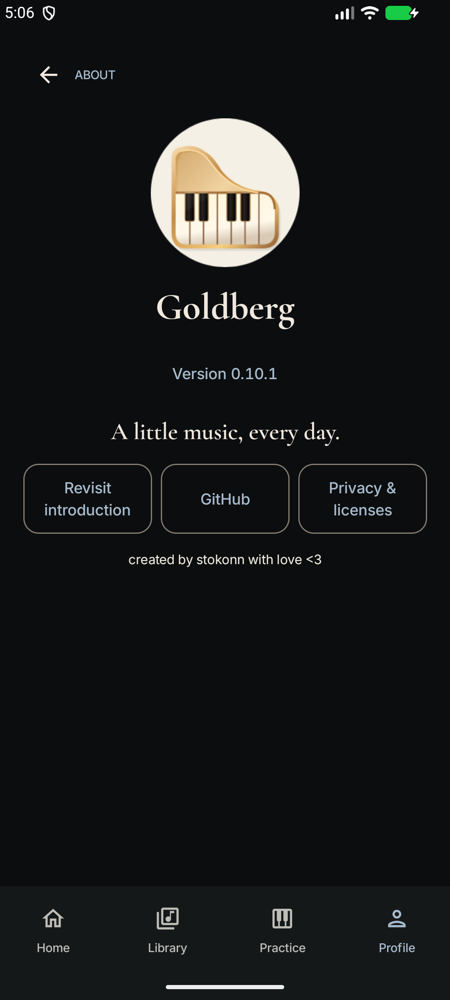

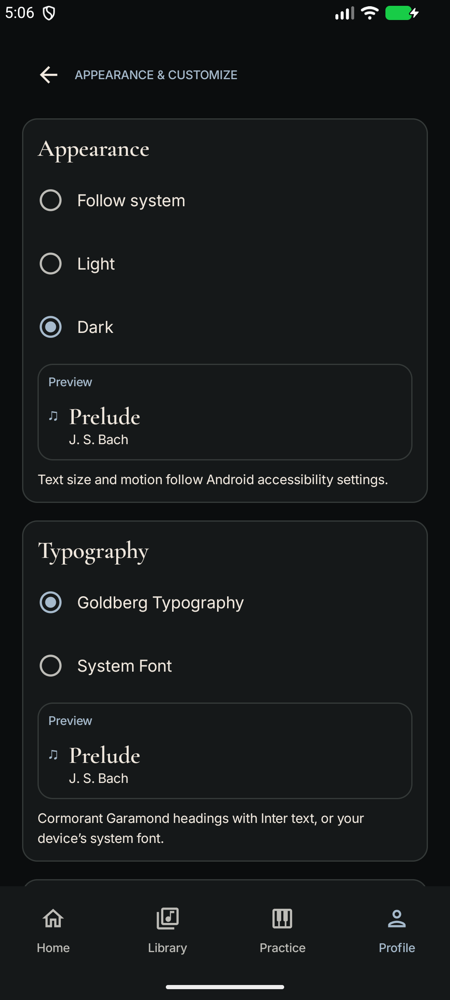

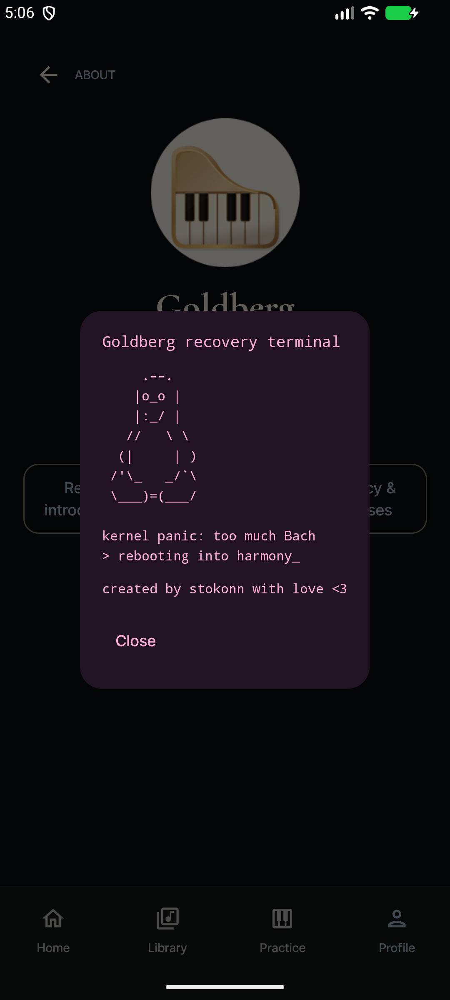

## Historical development screenshots

These are actual emulator captures of the 0.10 verification build, using controlled test data. They are not physical-device verification. The Google scenarios reported below were manually tested by the owner.

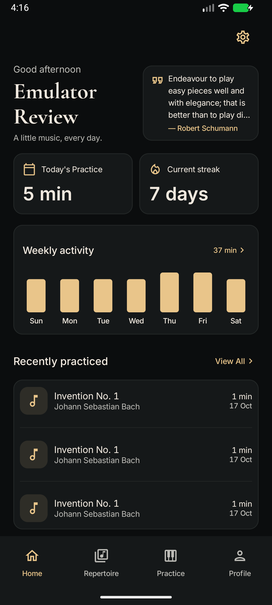

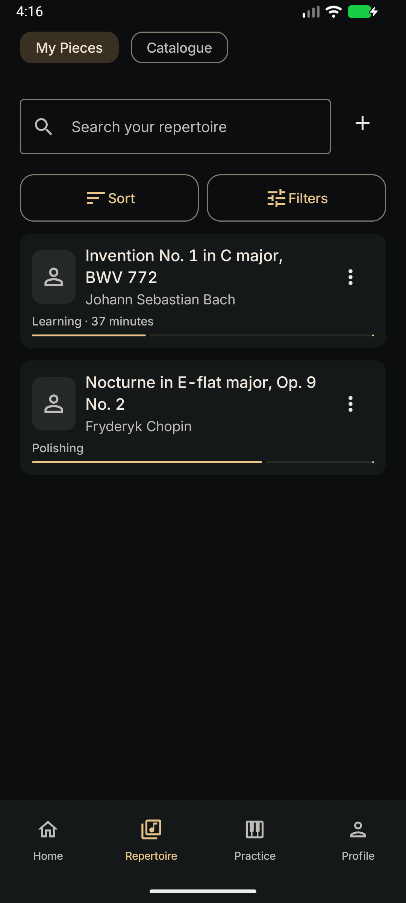

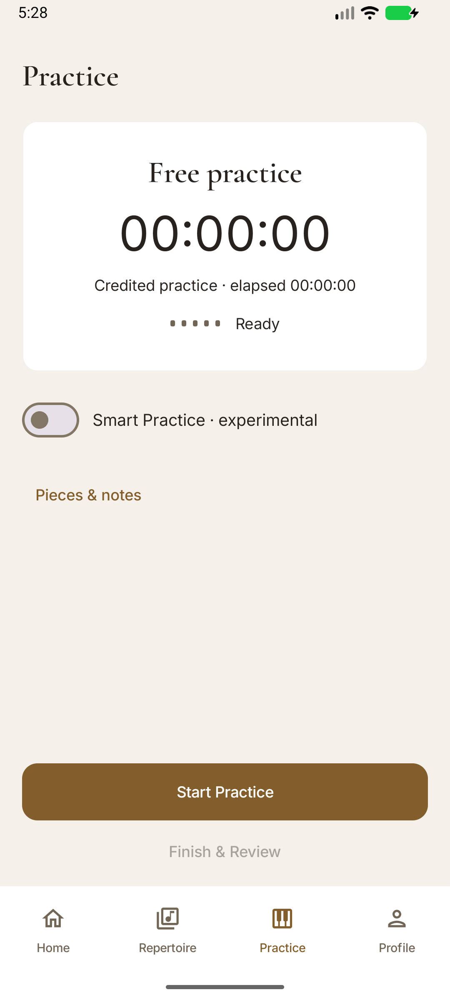

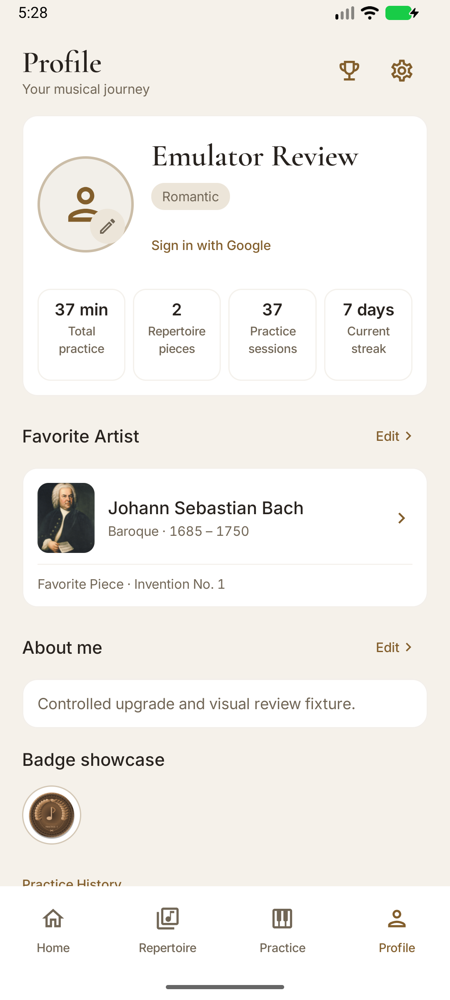

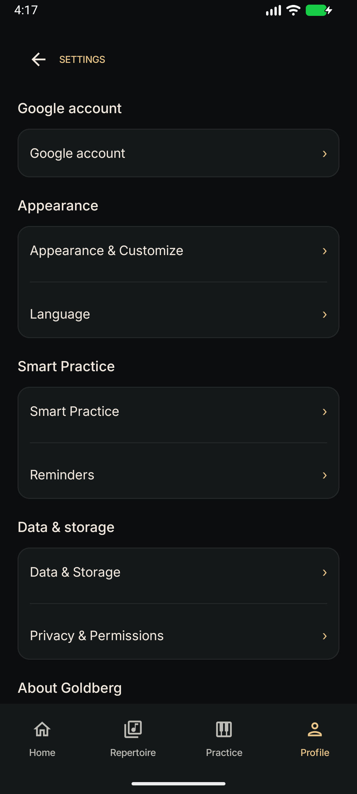

The Bach's Secret keyboard and Tux terminal captures below are retained from the verified 0.9.2 emulator build; those screens were not recaptured for 0.10.

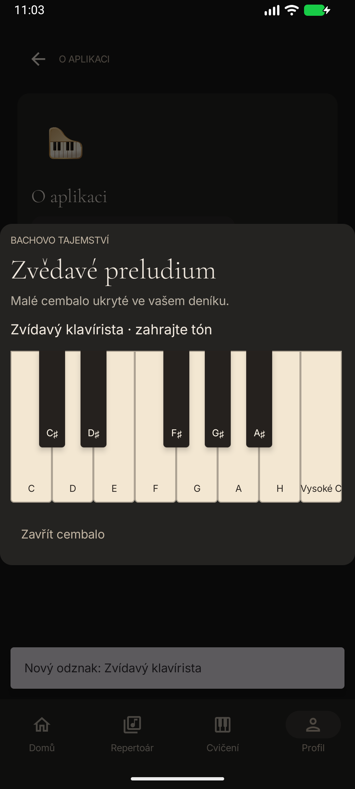

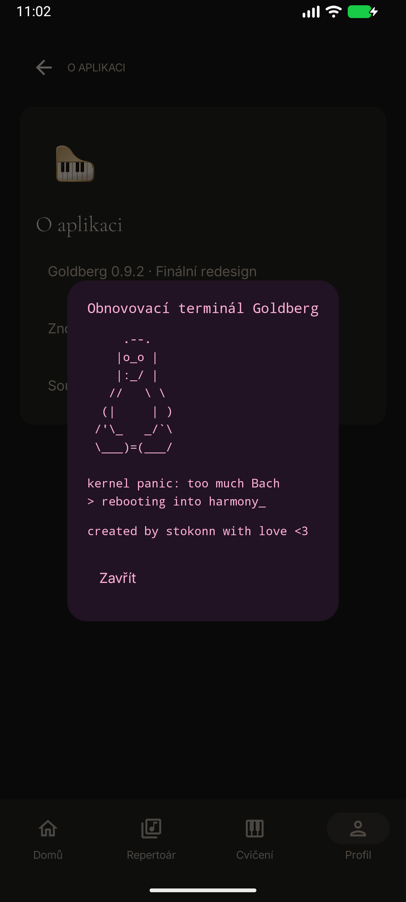

[Verification status](Verification) separates automated/emulator checks from the owner’s manual report. The six 0.10 Google scenarios are recorded as PASS — owner-reported manual verification.

